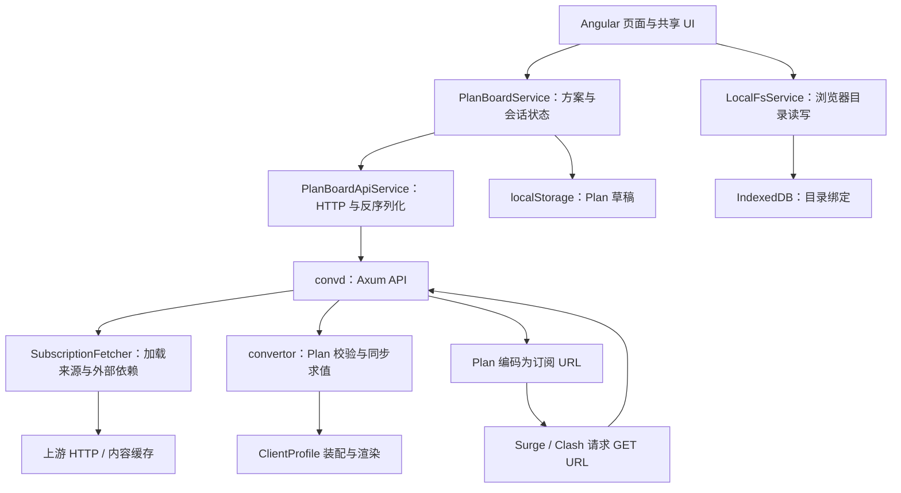

# Convertor 全前端重设计交接文档

适用：Figma Make / Claude Design，以及后续前端实现。

核对日期：2026-10-08。依据：`codex/feature/plan-workbench` 分支、基线提交 `49708bb`，**包含当前工作区未提交的改动**。本文核对了源码、路由、类型、接口和样式，未做运行截图或线上功能验证。

本文是一份自包含的设计输入：前半部分说明产品、DSL 能力、编辑器选项和交互，后半部分提供技术架构与接入资料。设计原型可以使用模拟数据；正式实现以当前 Rust / TypeScript 契约为准。**设计时先理解第 1 节的可视化 DSL 定位，再按第 4.6～4.11 节确定控件与选项。**

> **任务核心：为后端已有的 Plan DSL 设计顺手的可视化编辑器。以编排规则的创建、组合、排序、引用和调试为中心，让 UI 操作准确产生后端能够 evaluate 的方案。**

## 1. 产品定位与本次范围

Convertor 读取代理订阅配置，组织节点、策略组和分流规则，生成 Surge / Clash 可使用的配置及订阅 URL。

主要用户已经理解“订阅、节点、策略组、分流规则”，希望通过可视化操作完成编排，减少直接修改配置文本的工作。核心使用环境是桌面浏览器；窄屏需要支持查看、编辑和导出。

本次重设计覆盖：

1. 多来源的添加、读取、刷新、筛选与资源浏览。
2. 节点选择、标签标注、自动分组、自定义策略组和成员条件。
3. 有序规则编排，包括手工规则与来源规则块。
4. 编排预览、问题定位、配置文本、订阅链接生成与方案恢复。
5. 当前浏览器草稿、外观设置、响应式布局和共享组件体系。
6. 旧的单订阅快速转换、本地 Surge 配置注入和后端状态能力的迁移安排。

本次最优先打磨的是**编排编辑本身**：条件如何建立、如何组合，成员从哪里来，规则块如何排序，目标如何映射，结果为什么这样生成。来源浏览、主题与工具围绕这个编辑任务安排。

### 1.1 UI 是 Plan DSL 的可视化编辑方式

设计工具需要理解 DSL 的操作集合和语义，才能决定下拉选项、联动字段、列表顺序和有效引用。终端用户则通过对象名称、条件行、规则块和预览进行操作。

```text
用户操作可视化编辑器
  → 修改 Plan 的结构化语法树（AST）
  → 序列化为既有 Plan JSON
  → 后端 evaluate(plan, source_profiles)
  → 返回结果、诊断与追踪
  → UI 展示结果并定位到对应编辑位置
```

本文区分两层语言：

- **完整编排 DSL = Plan**：包含来源标注与过滤、自动分组、自定义组及成员、分流规则、输出设置。
- **分流规则程序 = Plan.rules**：其中一个有序子程序，由 Emit / Take 构成，决定哪些流量规则进入配置及其目标。

后端 evaluate 计算方案如何生成配置。真实流量是否匹配 DOMAIN-SUFFIX、GEOIP 等规则，由 Surge / Clash 在运行时决定。UI 的“来源规则筛选条件”匹配规则的元数据，不是在模拟真实网络请求。

设计交付需要证明“编辑 → Plan → evaluate → 结果定位”的闭环。可以提供自然语言摘要、结构预览或只读 JSON，帮助理解；常规操作通过可视化 DSL 完成。

以下是当前产品边界，设计中应保持：

- 没有登录、注册、团队、计费和用户中心。
- 服务端不保存用户方案。上游内容可以有缓存，但不存在“云端方案记录”。
- 方案定义由最终 URL 携带；浏览器草稿是当前设备的本地数据。
- 第一阶段没有 WebDAV、Git、网盘和跨设备自动同步。
- 同一个 Plan 使用统一的客户端格式：Surge 或 Clash。不能把两种格式的来源直接混进同一个 Plan。
- 前端负责编辑和展示；正式解析、编排、校验、渲染由 Rust 后端执行。
- 订阅内容、方案 URL 可能包含访问凭据，设计需要就近说明其分享含义。

## 2. 当前实现与重设计需要覆盖的功能

“已有”表示当前源码存在该能力，不代表本次已做浏览器或线上验证。

| 功能 | 当前实现 | 重设计要求 |
| --- | --- | --- |
| Surge / Clash 选择 | 工作台已有两个客户端入口 | 清晰显示当前格式；切换后重新读取来源、更新预览 |
| 多来源输入 | 远程完整 URL、内嵌配置文本 | 支持新增、命名、编辑、删除、加载、强制刷新 |
| 来源加载状态 | 未加载、加载中、成功、失败、上次加载时间 | 区分读取失败与读取成功但没有节点；允许重试 |
| 输入节点浏览 | 搜索、多选、按地区/来源/协议/原始标签分层浏览 | 保留快捷浏览；浏览层级不能悄悄修改输出分组 |
| 从选择创建组 | 勾选后创建；可拖入符合条件的组 | 提供按钮入口；拖拽代表添加引用，输入节点仍保留 |
| 标签标注 | 来源内条件追加标签；页面可按标签聚合编辑 | 显示原始标签与自定义标注的区别、适用来源和命中结果 |
| 来源过滤 | 来源内节点条件 | 说明“满足条件的节点被保留”；展示过滤影响 |
| 自动组策略 | 有序维度逐层分桶；顶层自动组直接输出 | 明确维度先后顺序及生成树；派生组回到所属策略修改 |
| 自定义组 | 命名、组行为、有序成员选择器、顶层输出开关 | 清晰表达组、节点、引用与选择条件之间的关系 |
| 条件编辑器 | 全部/任一/取反/原子条件，可嵌套 | 用结构化表单表达，提供当前命中与错误定位 |
| 规则编排 | Rust 和 TypeScript 模型已有；当前工作台没有规则编辑入口 | **需要补齐设计与前端编辑界面**，复用现有规则协议 |
| 结果预览 | 输出组树、成员、诊断、定位轨迹、配置文本 | 让“条件 → 命中资源 → 最终输出”可双向定位 |
| 订阅生成/恢复 | POST 编码 Plan；从完整 URL 解码恢复 | 主操作清晰；修改后提示重新生成并替换客户端链接 |
| 草稿 | 单个 Plan 自动写入当前浏览器 localStorage | 恢复、清空可发现；不要表现为服务端保存或多方案库 |
| 本地 Surge 注入 | 当前工作台可选目录、预览并写入主配置头部 | 保留可选工具；写入前展示文件和内容变化 |
| 旧单订阅转换 | 旧页面与服务仍在，当前没有挂载到路由 | 可作为“快速转换”次级入口迁移，明确其独立参数 |
| 旧规则文件合并 | 旧页面存在主配置头部及规则受管块的差异选择 | 若保留，迁移完整预览流程；不要声称当前工作台已集成 |
| 后端状态 | API 和旧页面已有，当前工作台顶栏未集成 | 建议小型状态入口，展示版本和依赖说明 |
| 外观设置 | 深/浅/跟随系统、配色、密度、圆角 | 保留能力，统一为一套设计变量 |
| 组件实验室 | 已有独立页面，演示共享 UI | 保留为设计系统验证入口，不承担用户业务 |

当前真实路由为：

| URL | 当前内容 |
| --- | --- |
| `/dashboard/` | 重定向到组件实验室 |
| `/dashboard/ui-component` | 组件实验室 |
| `/dashboard/plan-board` | 编排工作台 |

建议新产品默认进入工作台。导航和页面划分可以重做，不必继承当前默认入口或三栏布局。旧 `page/dashboard/` 与 `archive/dashboard/` 不应当作当前主入口。

## 3. 用户需要理解的对象

| 对象 | 用户语言 | 设计含义 |
| --- | --- | --- |
| Plan | 方案 | 保存输入和编排规则，不冻结未来的订阅内容 |
| Source | 来源 | 一个有名称的订阅 URL 或内嵌配置 |
| SourceProfile | 最近一次读取的来源快照 | 当前编辑会话用于计算的内容，具有读取时间和指纹 |
| InputNode | 输入节点 | 已准备外部节点依赖，但尚未应用方案标注和来源过滤 |
| Annotation | 标签标注规则 | 在某来源中，满足条件的节点获得指定标签 |
| Node filter | 来源过滤 | 全局影响该来源的节点消费路径 |
| GroupingPolicy | 自动组策略 | 对所有保留节点，按有序维度生成组树 |
| CustomGroup | 自定义策略组 | 有固定名称、组行为及有序成员来源 |
| MemberSelector | 成员来源/选择条件 | 描述这个组现在和未来应该选入什么 |
| RuleBlock | 规则块 | 保留顺序的手工规则或来源规则选择 |
| EvaluationReport | 编排结果 | 节点、组、诊断、追踪及可用的输出配置 |
| Output | 输出设置 | 自定义输出根、额外节点、唯一兜底和基础设置来源 |

方案、快照和结果必须在界面中保持可辨别：

- **修改方案**：条件或结构变了，需要重新求值、重新生成 URL。
- **刷新来源**：方案可以不变，当前快照及匹配结果可能改变。
- **仅搜索/折叠/切换浏览层级**：只是查看方式，不改变方案定义。
- **复制 URL**：复制了一份方案定义，不代表客户端已经替换链接或成功更新。

## 4. DSL 语义与后端能力目录

### 4.1 来源、标签与过滤

- 远程 URL 是已经完整拼好的 HTTP(S) 地址；工作台不自动补机场参数或调用提供商登录接口。
- 内嵌配置是真实来源类型，内容会进入 Plan；它与临时上传快照的概念不同。
- 标注规则归属于来源。可以按“家宽”这样的标签聚合展示，但保存时仍保留各来源的独立规则。
- 同一轮全部标注读取原始节点及原始标签，合并新增标签后再执行来源过滤。标注 A 新加的标签不会成为标注 B 的本轮输入。
- 删除一个标注只移除它贡献的标签；原始标签或其他标注仍可提供同一标签。
- 来源过滤是“保留条件”，例如排除测试节点应表达为“不具有测试标签”。它不删除上游内容。
- 输入浏览器当前展示原始标签；编排结果展示生效标签。新设计可以提供视图切换，但应注明正在查看哪个阶段。
- 原始资源还可能包含 include、注释、provider 或 policy-path。未展开与已加载为空是不同状态。

### 4.2 条件编辑

| 对象 | 可匹配字段 |
| --- | --- |
| 节点 | 名称、协议、服务器、端口、标签是否存在 |
| 来源原始组 | 名称、类型 |
| 自动生成组 | 名称、深度、维度路径中的值 |
| 来源规则 | 类型、值、映射前的原始目标名 |

字符串条件支持：等于、属于完整名称列表、包含任一、开头是、结尾是、正则。

当前工作区的“包含任一”支持英文或中文逗号分隔多个子串，命中任一个即成立；“属于”保存的是完整字符串列表，两者不可混用。普通匹配区分大小写，正则有显式的忽略大小写选项，正式正则语义来自 Rust regex。

组合条件支持“全部满足 / 任一满足 / 不满足”。空的“全部满足”为真，空的“任一满足”为假。界面应直接说明空条件的含义。

指定节点最终保存为来源内的名称条件，而非永久绑定某个服务器：当前拖选使用逐个精确名称条件，协议也支持完整名称列表。同来源出现同名节点时，一个精确名称条件可能命中多个节点，应让用户看到这个影响。

### 4.3 两种分组操作必须分开

**浏览分组**：按地区、来源、协议、原始标签组织输入列表，便于查找，仅改变当前视图。

**自动组策略**：写入 Plan，对标注、过滤后的所有来源节点逐层分桶，影响最终配置。

例如“地区 → 来源”和“来源 → 地区”会生成不同组树。标签维度代表“具有这个标签 / 不具有这个标签”两桶，不是任意标签自动展开，也不只是筛选有标签的节点。

- 每项自动策略的顶层组天然进入最终输出，无需额外勾选输出根。
- 自动策略自身没有独立节点范围；缩小范围应使用现有来源过滤或自定义组选择。
- 不创建任何自动策略也是合法方案：所有保留节点平铺输出，不生成自动组。
- 自动组由策略和维度路径决定；展示名称不是身份，重名时可能产生输出后缀。
- 家宽属于标签和自定义组场景；新编排不要凭空添加旧转换流程中的隐式家宽组。

### 4.4 自定义组与成员

自定义组支持两种行为：手动选择、自动测速。自动测速参数是探测 URL、间隔秒数、容差毫秒数。这是在配置客户端行为，不能显示成前端已经测出的节点延迟。

成员添加需要覆盖六种协议类型：

| 用户操作 | 保存语义 |
| --- | --- |
| 从某来源选节点 | 来源 ID + 节点条件；逐个勾选是该类型的快捷入口 |
| 取原始组中的节点 | 选择原始组，并选择只取直接节点或递归展开 |
| 保留原始组为子组 | 导入原始组结构及其依赖 |
| 引用自动生成的组 | 按组名/深度/维度选择，可选顶层或全部层级 |
| 引用其他自定义组 | 使用稳定组 ID |
| 添加内置动作 | DIRECT / REJECT |

“展开组取节点”与“保留组结构”需要不同的说明。节点可以被多个组使用；拖拽添加成员不会从来源或其他组移走节点。

成员来源块有顺序；资源按身份去重并保留首次出现。不能根据勾选先后暗示节点会改变原始遍历顺序。

当前拖入节点只允许目标组完全由逐个精确名称节点选择器构成，包含动态条件或组引用时禁用。新设计至少保留这个限制及可解释的禁用状态；如要改变语义，需另行修改业务逻辑。

### 4.5 输出、空组与规则

- 自动策略根直接输出；自定义组可选为顶层输出，也可通过其他组、规则或兜底被引用。
- 有自动策略时，最终输出收集可达资源；没有自动策略时，保留节点还会作为平铺输出根。
- `extra_nodes` 用于显式输出未被组/规则引用的节点；当前界面还没有完整编辑入口。
- 普通选择未命中不会自动成为阻断错误。空组及仅引用空组的父组会被省略；目标为这些空组的普通规则也会省略。
- **如果唯一兜底引用空组，则报 `empty_fallback_group` 并阻断输出。** 不应把所有空组都设计成同一种错误。
- 自定义组重名、非法引用、循环、无效正则等由后端报告诊断。
- 所有声明的自定义组都会校验，即使当前未被选择为输出根。
- General / DNS 等基础设置来自一个指定来源，不自动合并多个来源设置。

规则核心是“顺序 + 匹配内容 + 目标”：

1. **手工规则块（Emit）**：在当前位置加入结构化规则和指定目标。
2. **来源规则块（Take）**：选择某来源的规则，保留其原顺序，再处理目标。

来源规则目标处理支持“统一替换 / 保留来源目标 / 按条件映射”。映射按顺序取第一条匹配，并显式选择未命中时“报错 / 丢弃 / 保留 / 使用固定目标”。

规则不自动去重、排序或优化。来源 FINAL/MATCH 不进入普通规则；手工规则不能额外添加终结项，最后由输出设置生成唯一 Surge FINAL 或 Clash MATCH。普通规则目标为自定义组或 DIRECT / REJECT；要指向自动组，可由自定义组承接。

### 4.6 给设计工具的 DSL 操作目录

下面列的是**当前后端能表达的正式操作**。中文名称用于界面，协议键用于实现映射，不要求直接显示给用户。不同编辑器只显示本对象支持的操作；不能使用一个无上下文的“大而全”下拉框。

| 编辑位置 | 正式操作/字段 | 必须出现的编辑能力 |
| --- | --- | --- |
| 来源输入 | `remote` / `inline` | URL 或配置正文，按类型切换字段 |
| 来源标注 | `annotations: [{ when, add_tags }]` | 节点条件 + 一个或多个标签 |
| 来源过滤 | `node_filter: null / Predicate<NodePredicate>` | 不过滤或保留条件 |
| 自动组策略 | `group_by: NodeDimension[]` + `strategy` | 有序维度 + 组行为 |
| 自定义组 | `name` + `strategy` + `member_selectors[]` | 名称、行为、有序成员选择块 |
| 分流规则程序 | `rules: RuleBlock[]` | 混合有序 Emit / Take 块 |
| 输出 | `roots / extra_nodes / fallback / settings_source` | 自定义输出根、额外节点、唯一兜底、基础来源 |

DSL 没有任意脚本、变量赋值、用户自定义函数、循环语句或通用 if/else 语句。条件树可嵌套，Map 有有序条件分支；标签、来源和组通过已有字段与引用连接。

**设计上可以合并步骤或提供快捷动作，但保存语义必须展开回现有操作。** 例如“选中四个节点并标为家宽”可以是一键操作，保存为来源内的精确名称条件与 add_tags；“香港优选”可以是模板，展开为现有组与成员选择器。

### 4.7 条件编辑器：字段 → 运算符 → 值

逻辑层选项是固定集合：

| UI 名称 | 协议 `op` | 子项形态 | 语义 |
| --- | --- | --- | --- |
| 全部满足 | `all` | 条件数组 | AND；空数组始终满足 |
| 任一满足 | `any` | 条件数组 | OR；空数组始终不满足 |
| 不满足 | `not` | 一个子条件/条件组 | NOT；不接受多个平级子条件 |
| 单个条件 | `atom` | 当前领域的原子条件 | 字段、运算和值 |

字符串匹配选项也是固定集合：

| UI 名称 | 协议 `op` | 值控件 | 语义与联动 |
| --- | --- | --- | --- |
| 等于 | `equals` | 单个文本值或可搜索候选 | 完整相等 |
| 属于列表 | `one_of` | 多值标签/chips | 任一完整值相等；保存字符串数组 |
| 包含任一 | `contains` | 子串列表/chips | 任一子串出现；当前保存为逗号分隔字符串 |
| 开头是 | `starts_with` | 单个文本值 | 字符串前缀 |
| 结尾是 | `ends_with` | 单个文本值 | 字符串后缀 |
| 正则 | `regex` | 表达式 + 忽略大小写开关 | 保存 pattern、case_insensitive；使用 Rust regex |

“不等于”“不包含”“没有标签”可以作为 UI 快捷选项，但应转换为 `not(atom(...))`，而不是新增协议运算符。字符串 chips 必须解释逗号分隔的限制；包含条件不能把有逗号的一个子串悄悄当成两个。

字段决定允许的运算与输入类型：

| 条件领域 | UI 字段 | 协议字段 | 允许的值/运算 |
| --- | --- | --- | --- |
| 节点 | 名称 | `name` | 六种字符串匹配；候选从当前来源节点读取 |
| 节点 | 协议 | `protocol` | 六种字符串匹配；优先提供当前来源出现的协议 |
| 节点 | 服务器 | `server` | 六种字符串匹配 |
| 节点 | 端口 | `port` | 精确数值，u16；没有范围或大小比较运算 |
| 节点 | 具有标签 | `has_tag` | 一个完整标签名；判断存在，无 contains/regex 运算 |
| 来源原始组 | 名称 | `name` | 六种字符串匹配；候选来自该来源原始组 |
| 来源原始组 | 类型 | `kind` | 六种字符串匹配；原始类型包含 select / url-test / smart |
| 自动组 | 名称 | `kind: name` | 六种字符串匹配；匹配选择阶段的名称 |
| 自动组 | 深度 | `kind: depth` | 一个整数；顶层展示深度为 1 |
| 自动组 | 维度值 | `kind: dimension` | 选择维度及精确值，不是字符串匹配运算 |
| 来源规则 | 类型 | `kind` | 六种字符串匹配；建议规则类型选择器 |
| 来源规则 | 值 | `value` | 六种字符串匹配 |
| 来源规则 | 原始目标名 | `original_target_name` | 六种字符串匹配；读取映射之前的来源目标 |

节点条件不能选择规则类型，规则条件不能选择节点标签。端口没有“包含”，标签没有“正则”，规则值没有独立“节点是否属于某组”谓词。未在目录内的字段若要增加，应列为协议扩展。

候选有两种来源：**协议固定枚举**（运算符、成员类型、目标处理），以及**当前 Plan / 快照数据**（来源、标签、原始组名、原始目标名、自定义组）。动态候选显示名称，引用保存稳定 ID；字符串条件保存实际字符串值。

自动组维度值应从报告提供的维度路径取候选：地区保存 code（如 HK），来源保存 ID 的字符串，协议保存协议名，标签是否存在保存字符串 true/false 并带标签名。不要把显示用“香港”保存为地区 code。

### 4.8 组编辑器：选项与联动字段

| 下拉位置 | 固定选项 | 联动字段与约束 |
| --- | --- | --- |
| 新建组行为 | 手动选择 `select`；自动测速 `url_test` | 后者显示完整 HTTP(S) 探测 URL、正数 interval_secs、非负 tolerance_ms |
| 自动分组维度 | 地区 `region`；来源 `source`；协议 `protocol`；是否具有标签 `has_tag` | has_tag 追加标签名；列表顺序从外到内；策略至少一个维度 |
| 成员来源类型 | `nodes` / `nodes_from_groups` / `import_groups` / `base_groups` / `group` / `builtin` | 见下面的字段联动表 |
| 原始组展开深度 | 直接 `Direct`；递归 `Recursive` | 仅用于 nodes_from_groups |
| 自动组查找范围 | 顶层 `Roots`；所有层级 `All` | 仅用于 base_groups；层级条件仍可继续缩小范围 |
| 自动组策略范围 | 全部策略，或某一现存策略 | policy 为可选历史范围；默认跨全部策略，不强迫绑定策略 ID |
| 内置动作 | DIRECT → `Direct`；REJECT → `Reject` | 仅两种 Plan Builtin，不新增 PASS / REJECT-DROP 等创建选项 |

| 成员类型 | 应显示的字段 | 应隐藏的字段 |
| --- | --- | --- |
| 从来源选节点 `nodes` | 来源 + 节点条件 | 展开深度、自动策略范围 |
| 展开原始组 `nodes_from_groups` | 来源 + 原始组条件 + 展开深度 | 节点条件、自动策略范围 |
| 保留原始组 `import_groups` | 来源 + 原始组条件 | 展开深度；语义固定为保留结构 |
| 选自动组 `base_groups` | 查找层级 + 自动组条件，可展开策略范围 | 来源选择、原始组展开深度 |
| 引用自定义组 `group` | 当前 Plan 的自定义组选择 | 所有条件字段 |
| 内置动作 `builtin` | DIRECT / REJECT | 来源、条件和层级 |

原始组的类型下拉可以出现 smart；这不代表新建自定义组可创建 smart。新建组只支持 select / url_test。引用自定义组时排除自身，其他循环交由 evaluate 检查，前端也可提前提示。

自动分组维度“是否具有家宽”会生成有/无标签两桶；只要家宽节点的需求应通过节点条件建立自定义组。当前页面限制同类维度重复选择，这是现有 UI 选择；后端的 group_by 为有序数组，不能把 UI 限制描述为额外的协议枚举规则。

### 4.9 分流规则编辑器：操作、匹配与目标

规则块类型：

| UI 操作 | 正式变体 | 必需字段 | 编辑方式 |
| --- | --- | --- | --- |
| 添加手工规则块 | `Emit` | rules: ManualRule[] | 块内有序规则行；类型、值、目标、选项、注释 |
| 引用来源规则块 | `Take` | source、predicate、targets | 来源 + 规则元数据条件 + 目标处理；原始规则只读 |

新增手工规则的“类型”应按当前 RuleType 制作下拉：

| 类型 | 值输入提示 | 设计限制 |
| --- | --- | --- |
| DOMAIN | 完整域名，如 api.example.test | 普通手工规则 |
| DOMAIN-SUFFIX | 域名后缀，如 example.test | 普通手工规则 |
| DOMAIN-KEYWORD | 域名关键词 | 普通手工规则 |
| PROCESS-NAME | 进程名称 | 普通手工规则 |
| USER-AGENT | User-Agent 匹配值 | 普通手工规则；不是节点属性筛选 |
| GEOIP | 地区值，如 CN | 普通手工规则 |
| IP-CIDR | IPv4 网段，如 192.0.2.0/24 | 普通手工规则 |
| IP-CIDR6 | IPv6 网段，如 2001:db8::/32 | 普通手工规则 |
| RULE-SET | 已解析规则依赖的 key | 高级入口，必须说明依赖上下文 |
| FINAL / MATCH | 不提供普通值输入 | 只读来源终结项或唯一兜底，不可添加为手工规则 |

这张表描述后端现有的表达类型；不能仅因为枚举中存在就声称已在所有 Surge / Clash 版本实测兼容。当前没有完整按客户端区分的兼容矩阵。

RULE-SET 选择和目标映射针对来源的原始规则条目执行，然后展开子规则；子规则继承选定的目标，并合并父级选项。若要对展开后的子规则再次独立筛选，当前 Take 没有这个执行阶段。

手工 RULE-SET 从 output.settings_source 的依赖表解析；来源 Take 从所选来源解析。它不是一个“粘贴任意新 URL 后自动下载”的独立规则集来源功能。依赖缺失、规则集循环、集合内终结规则等会阻断 evaluate。

ManualRule 同时有 rule 与 target，真正的动作来自外层 target，rule.target 被编排目标替换。UI 只提供一个目标选择器，序列化时可令内层 rule.target 为 null。`options` 是有序字符串数组，`comment` 为可空文本；当前没有完整的固定选项枚举或逐客户端选项校验。已知选项可做 chips/快捷项，例如 no-resolve，其余应保留为高级输入而非虚构一份“后端支持选项”下拉。

目标处理下拉：

| UI 名称 | 正式变体 | 联动字段 | 语义 |
| --- | --- | --- | --- |
| 统一替换目标 | `Replace` | 一个 Target 选择器 | 所选规则统一采用该目标 |
| 保留来源目标 | `Preserve` | 来源目标说明，无新目标选择器 | 保留目标并收集所需原始组/节点依赖 |
| 按条件映射目标 | `Map` | 有序 cases + 未命中处理 | 对每条原始规则取第一条匹配分支 |

Map 分支的条件使用 RulePredicate，字段仍只有类型、值和原始目标名。新目标 Target 只有“某自定义组 / DIRECT / REJECT”；不能直接选择原始组或自动组 identity。保留原始目标使用 Preserve；路由到自动组使用自定义组承接。

Map 的“没有分支匹配时”是必填选择：

| UI 名称 | 正式变体 | 联动字段 |
| --- | --- | --- |
| 报错并阻断 | `Error` | 无 |
| 丢弃该规则 | `Drop` | 无 |
| 保留来源目标 | `Preserve` | 无，展示来源依赖说明 |
| 使用固定目标 | `Use` | 一个 Target 选择器 |

这里的“第一条匹配”仅指 Map 内部的分支。多个 Take 块可以选中同一来源规则，后端不会自动停止后续块，也不会去重；最终顺序仍按全部规则块和块内来源顺序展开。UI 不应把整份编排画成命中某块就停止的通用 if/else。

### 4.10 与 DSL 对齐的编辑体验

设计优先提供“选择对象 → 声明条件 → 定义动作 → 解释结果”的连续操作：

1. 先选成员类型或规则块类型，再展示适用字段；常用模板可以直接展开这些字段。
2. 条件行显示中文字段、适用运算和类型正确的值控件；候选可搜索、可批选。
3. 自然语言摘要由当前 AST 生成，与表单和结构预览使用同一份数据，不另存一段待解析文本。
4. 调整条件括号或 AND/OR 时展示影响；改变实体类型时保存临时输入或提示被清除的字段。
5. 规则块、Emit 内规则、Map 分支、成员选择块和分组维度分别排序，不把不同顺序混为一次“优先级排序”。
6. 编辑数据仍未完整时保留局部草稿并显示待补字段；合法表单序列化为既有类型。字段类型错误可提前检查，语义有效性仍以 evaluate 为准。
7. 显示选中数、匹配数、生成数和输出数的区别；预览过期时冻结有效结果定位。
8. 诊断可跳回所在条件、规则块或引用位置；稳定实体 ID 与规则数组路径需要由 UI 做定位映射。

规则“启用/停用”没有正式 enabled 字段。若设计此快捷交互，可把停用条目保存在本地编辑元数据中，并在生成 Plan 时省略；恢复时再加入。需要明确这类停用草稿不会随正式 URL 完整往返，不能直接给协议新增 enabled 字段。

一键模板、批量操作、复制规则块、移动位置都可以改善操作，只要能精确展开成现有 Plan，且不重排未选中的操作。是否采用拖拽卡片、紧凑表格或分栏编辑由设计决定。

### 4.11 evaluate 与原型的职责

前端可以检查必填、类型、引用候选、局部循环和合法操作组合，并用于即时反馈；正式语义、来源依赖、正则、资源可达性和渲染结果仍由后端计算。提交范围是完整 Plan 与来源快照，当前没有“执行任意一个 DSL 表达式”的独立 API。

原型使用模拟 evaluator 时，应覆盖被演示的操作及顺序，明确未模拟的高级能力。JavaScript 的正则检查不能当作 Rust regex 校验。只读结构预览应展示真实 Plan 形状，标签显示名与引用值分开保存。

当前报告有 diagnostics、trace、最终 Profile 和资源状态；规则 trace 主要关联规则块/来源条目及目标资源。它还没有完整的“每条展开输出规则来自哪个规则集、命中了 Map 的哪一分支”的专门字段。逐条来源说明、分支命中统计、跳过原因等可以设计，但正式实现需补充前端解释数据或后端报告契约，不能把模拟说明当作现有字段。

DSL 验收必须包括往返：导入 Plan 后能够恢复对应操作、运算、值类型、嵌套与顺序；编辑并导出后这些语义保持一致。若某种正式结构暂不支持编辑，应展示明确的只读状态并保留数据，不静默改写或丢弃。

## 5. 建议信息架构与主要界面

以下是设计建议，不是必须照搬的页面划分。

### 5.1 工作台外壳

桌面默认呈现“资源浏览 → 当前编辑对象 → 结果检查”的连续关系。可以采用可调宽三栏，也可以采用实体列表、主编辑区和按需打开的预览。设计优先保证当前任务有足够空间。

顶栏建议放：品牌、当前客户端、草稿/结果状态、来源管理、生成订阅链接、外观及小型服务状态入口。

当前 Plan 没有方案名称、方案 ID 或云端项目字段。若设计一个显示用方案名，应明确它是新增本地元数据；不要将其直接塞进正式 Plan 协议。

### 5.2 来源与资源

- 来源列表显示名称、类型、加载状态、时间和真实可用节点数。
- 新增来源表单先保留局部输入，提交“添加并加载”后才写入方案。
- 编辑已保存 URL 后显示“输入已修改，需要重新读取”，不能继续把旧快照当有效输入。
- 普通加载和强制刷新分开：强制刷新还涉及外部依赖缓存。
- 资源浏览提供节点、原始组、原始规则的清晰入口。后两项需要新增前端浏览界面，数据模型已有。
- 节点行/卡显示名称、来源、协议、标签，详情可展示服务器、端口及依赖来源。
- 同名节点保留独立身份，来源及必要的详情帮助辨别。
- 密集列表提供搜索、多选、结果内全选、取消选择；可以使用分页或虚拟列表。
- 凭据默认不铺在表格中；URL 和配置内容使用明确的查看/编辑入口。

### 5.3 标签与条件

- 展示标签名及其各来源的条件，可以从节点多选快捷创建精确名称标注。
- 支持增删条件、修改标签、查看命中及跳回来源。
- 用“这个来源中，满足这些条件的节点获得家宽标签”这样的自然语言摘要。
- 标签重命名若只改变标注，已有标签筛选条件不会自动更名；新设计应列出相关使用位置。若提供联动替换，需要实现明确的方案修改操作。
- 保留高级正则入口，通过可视化表单编辑 DSL 条件；JSON 可作结构查看与对接参考。

### 5.4 自动策略与自定义组

- 自动策略显示从外到内的有序维度、组行为、当前生成树与数量。
- 维度排序有拖拽和按钮替代方式。
- 自动生成的组是只读结果，点击后定位到策略及对应层级。
- 自定义组显示名称、行为、成员来源块、当前直接成员与最终输出状态。
- 区分直接节点、子组引用、内置动作；引用点击后可定位。
- 删除来源/组/策略前展示受影响引用，提供取消或修复路径。这需要新增前端交互，当前并没有完整删除影响向导。

### 5.5 规则工作区

规则界面是本次优先设计的核心工作区；操作集合及选项必须遵守第 4.9 节。建议让规则程序与最终展开结果相邻，选中一个块时打开其条件与目标编辑：

- 有序列表混排“手工规则块”和“来源规则块”。
- 规则行显示类型、值、目标、选项；来源块显示来源、筛选条件、目标处理和展开后数量。
- 支持添加、编辑、删除、插入位置、上移/下移；拖拽排序是辅助入口。
- 映射分支显示执行优先级和未命中行为。
- 展示最终展开顺序及唯一兜底，明确来源规则集在输出时会展开。
- 已省略的规则给出原因，例如目标组没有匹配成员；不要只展示消失后的列表。
- 不添加没有后端依据的“自动优化”“已验证无冲突”状态。

典型的一次操作应能顺畅完成：“添加来源规则块 → 选择来源 → 选择规则类型/原始目标名条件 → 按条件映射 → 添加两个分支 → 选择未命中行为 → 调整块顺序 → 检查最终展开结果”。其中每一步都对应现有 DSL 字段。

### 5.6 预览、诊断与导出

预览至少提供：

| 视图 | 应回答的问题 |
| --- | --- |
| 输出结构 | 最终有哪些组、节点和规则？哪些生成资源没有进入输出？ |
| 命中说明 | 这个选择条件匹配了什么？这个成员来自哪里？ |
| 问题列表 | 哪些是警告，哪些阻断输出？如何回到对应输入修改？ |
| 配置文本 | 当前正式渲染内容是什么？可复制哪些内容？ |
| 链接交付 | 这条 URL 对应什么方案状态？是否需要重新生成？ |

诊断主文案应使用对象名称和可执行的修复提示；原始 code、path 和 identity 可留在展开详情。没有结果、合法零结果和旧结果过期需要不同空状态。

导出区显示客户端、可复制 URL、长度相关提示、方案修改后的替换说明。可以设计 JSON 文件导入/导出及配置下载，但当前没有完整对应界面，应标为新增前端能力。

### 5.7 次级工具

- **快速转换**：保留旧单 URL 转换的最短路径，包含 Secret、客户端、订阅更新间隔、严格模式和各类结果 URL。
- **本地 Surge 配置**：授权目录、选主配置、查看改动、明确写入。当前工作台写入 `#!MANAGED-CONFIG` 头部；旧页面还提供规则受管块合并选择。
- **服务状态**：后端版本、HTTP 可达性、依赖状态及详细原因，不占据主要编辑空间。
- **外观**：主题模式、配色、密度、圆角及恢复默认。
- **组件实验室**：新组件和边界状态的独立验证页。

旧单订阅更新间隔、组内测速间隔、本地 Managed Header 更新间隔是不同字段，不能合并成一个“间隔”。当前工作台本地头部写入使用 `interval=86400 strict=true`，尚无独立编辑控件。

## 6. 状态与交互约束

### 6.1 主流程

```text
添加 URL / 内嵌配置
  → 加载来源与依赖
  → 浏览输入快照
  → 标注、过滤、定义分组和规则
  → 防抖请求后端求值
  → 检查结果与诊断
  → 生成 Plan 订阅 URL
  → 复制给客户端 / 可选本地注入
```

当前求值防抖为 300ms。请求结果要与发起时的方案版本和来源输入一致；过期响应不能覆盖较新的修改。设计需支持用户在异步操作进行时继续浏览，并清楚标识结果是否有效。

| 场景 | 界面状态与动作 |
| --- | --- |
| 首次进入空方案 | 清晰的添加首个来源入口，可提供独立演示方案 |
| 某来源正在读取 | 该来源加载标记；输出暂不可生成 |
| 读取成功但没有节点 | “已读取，0 个节点”，保留来源详情和诊断 |
| 刷新失败且有旧快照 | 旧内容可以查看，显示失败/过期，重试成功前不能生成有效新结果 |
| 方案修改、求值未完成 | 已有预览标为过期，禁用基于旧结果的定位和导出 |
| 只有警告 | 展示警告及影响；满足其他条件时可以导出 |
| 有错误级诊断 | 保留可用的诊断和部分资源信息，不显示可用正式渲染结果 |
| 普通组未命中 | 显示未生成/已省略及原因，不默认宣称导出失败 |
| 兜底指向空组 | 阻断导出，定位兜底及组条件 |
| 生成链接后改了方案 | 明确当前修改未包含在旧链接中，要求重新生成 |
| URL 恢复成功 | 先恢复定义，再重新读取来源，不能马上显示旧快照已恢复 |
| 来源刷新使选择过期 | 清理失效节点选择，要求用户基于新快照重新选择 |
| 本地目录权限失效/不支持 | 解释状态，提供重新授权或手动复制路径 |
| 本地存储失败 | 编辑仍可继续；设计保存提示前需补充写入结果记录 |

### 6.2 导出门槛与状态文案

当前前端允许生成 URL 的条件是：全部来源快照齐全、已有无错误报告、已有渲染内容、预览有效，且没有来源加载/错误、求值、生成或恢复中的冲突操作。

POST 生成接口本身主要负责校验和编码，不重新加载来源。因此“URL 编码成功”“当前快照预览成功”“客户端实际更新成功”是不同事实。

建议使用文案：“草稿已保存到此浏览器”“预览待更新”“当前预览有效”“有 2 项问题需要处理”“方案已修改，请重新生成链接”。草稿保存成功文案需要有实际存储结果支撑；当前写入失败被静默处理。

只刷新来源不等于修改方案。现有 URL 仍携带原定义，客户端下次请求会按服务器缓存策略读取来源并重新执行。同一个 URL 的未来结果可能变化；修改定义则需要生成新 URL 并在客户端替换。

当前前端在来源刷新时也会清空本次显示的 URL。新设计若要保留“上次导出”记录，需要单独保存其方案版本和状态，不能将该记录显示为已经验证的当前结果。

### 6.3 本地文件操作

目录读写使用浏览器 File System Access API，以运行时能力检测和权限结果为准。系统授权、用户取消、权限失效、文件丢失、读取失败、写入失败都应有明确反馈。

这项功能需要安全上下文和浏览器支持。它不能作为生成订阅链接的前置条件。打开或关闭工具面板不应清空方案；真实写入动作应与预览动作分开。

## 7. 视觉系统、组件与响应式

### 7.1 视觉方向

建议：专业工具界面、紧凑信息密度、清晰对象层级、可长时间使用的深浅主题。让空间主要用于列表、条件、组成员和结果。

允许重新设计品牌表现、配色、排版、导航和组件外观。当前像素值是参考，业务语义与状态区分需要保留。避免让大标题、装饰背景或大号统计卡挤压编辑区。

当前外观默认：深色 `githubdark`、浅色备选 `github`、极紧凑密度；控件/卡片/浮层/面板圆角为 8/12/16/16px。按钮圆角当前固定为 8px，其他部分存在独立配置。

| 密度 | 当前按钮高度 | 当前输入高度 | 当前卡片内边距 |
| --- | --- | --- | --- |
| 极紧凑 ultra | 24px | 28px | 8px |
| 紧凑 compact | 28px | 32px | 12px |
| 标准 comfortable | 32px | 36px | 16px |

新设计应分别考虑桌面紧凑密度和触屏操作面积，不必直接将 24px 按钮用于手机。中文界面为主；协议名、URL、规则关键字和配置文本保留必要英文。

### 7.2 设计变量

新的设计系统应能映射为语义变量：

| 变量组 | 当前对应 | 用途 |
| --- | --- | --- |
| 背景与表面 | `--ui-bg / surface / surface-low / surface-high` | 页面、容器、嵌套层和浮层 |
| 文本 | `--ui-text / muted` | 主文本、说明和元信息 |
| 强调 | `--ui-accent / accent-text / on-accent` | 主要动作、强调文字、强调色上的文字 |
| 交互 | `--ui-active / selection / on-selection / hover / border` | 激活、选择、悬停、边界 |
| 状态 | `--ui-error / success / warning / disabled` | 问题、成功、警告、不可用 |
| 形状 | control/card/overlay/panel radius | 不同层级的圆角 |
| 尺寸 | control/field/option height、gap、card padding | 密度和节奏 |

选中状态和关联高亮必须能同时存在：用户勾选了一批节点，与当前条件命中了一批节点，是两种信息。

### 7.3 组件交付清单

至少提供以下组件及其状态：

- 页面骨架、导航、可收起侧栏、尺寸分隔器、抽屉、Sheet。
- 按钮/图标按钮、输入、数值输入、多行输入、下拉、分段切换。
- 复选框、开关、标签页、可独立展开的折叠容器。
- 节点行/卡、分组树、成员引用、批量选择条。
- 嵌套条件编辑器、有序维度编辑、成员来源块、规则块及目标映射行。
- 状态标记、加载反馈、空状态、诊断行、问题定位入口。
- URL 交付、复制反馈、配置文本、文件变更预览。

当前正式组件实现统一位于 `page/shared/ui/`。业务页消费共享组件；Material/CDK 的控件实现封装在该层，业务 CDK 拖拽可直接使用。组件实验室只展示共享组件，业务不能依赖实验室实现。

如果沿用 Angular 落地，新视觉应在共享组件层实现，页面负责组合，不用页面深层样式覆盖或复制一套组件。

### 7.4 响应式与键盘

建议交付 1440×900、1280×800、1024×768 和约 390×844 的主要状态。这是设计验收尺寸建议，不是固定运行断点。

当前骨架默认左右宽度为 256/320px，最小宽度为左 160px、右 200px、主区 320px。响应式停靠/浮层切换依据容器可用宽度，而非仅判断设备名称。

- 宽屏可同时浏览输入、编辑和预览；窄屏优先保留当前编辑任务，其他区域可按需打开。
- 收起区域不保留空白占位；关闭面板保留输入、选中对象和编辑数据。
- 页面级模态浮层同时只打开一个；要有清楚的关闭入口、焦点回到触发位置及 Escape 行为。
- Tab、方向键、Enter 可完成选择；所有仅图标动作有文字名称。
- 拖拽创建/排序均有按钮或键盘替代入口。
- 长名称、长 URL、嵌套条件、多层组树需要真实样本验证。
- 错误、选中和禁用使用文字/图标/边界共同表达，不能只依靠颜色。
- 动画以反馈为目的，考虑减少动画偏好；异步结果不应造成主要区域突然跳动。

## 8. 原型演示数据与验收脚本

以下全部是设计用虚构数据。BosLife 名称只用于体现标注任务，不代表实时订阅；URL 使用 `.test` 域名，原型应通过模拟服务读取。

### 8.1 默认快照 A

当前客户端：Surge。来源 1：`BosLife · 演示`，8 个节点；来源 2：`备用订阅 · 演示`，4 个节点。

| 来源 | 节点完整名称 | 协议 | 原始标签 | 自定义标签 |
| --- | --- | --- | --- | --- |
| BosLife · 演示 | 🇭🇰 香港 01 | trojan | — | — |
| BosLife · 演示 | 🇭🇰 香港 02 | trojan | 专线 | — |
| BosLife · 演示 | 🇺🇸 美国 07 | trojan | — | 家宽 |
| BosLife · 演示 | 🇺🇸 美国 08 | trojan | — | 家宽 |
| BosLife · 演示 | 🇺🇸 美国 09 | trojan | — | 家宽 |
| BosLife · 演示 | 🇺🇸 美国 10 | trojan | — | 家宽 |
| BosLife · 演示 | 🇨🇦 加拿大 - 家宽 | trojan | — | 家宽 |
| BosLife · 演示 | 🇸🇬 新加坡 - 测试 | ss | 测试 | — |
| 备用订阅 · 演示 | 🇭🇰 香港备用 01 | ss | — | — |
| 备用订阅 · 演示 | 🇺🇸 美国备用 01 | trojan | — | — |
| 备用订阅 · 演示 | 🇯🇵 日本备用 01 | ss | — | — |
| 备用订阅 · 演示 | 🇸🇬 新加坡备用 01 | trojan | — | — |

默认方案：

- BosLife 标注一：“名称属于美国 07、08、09、10 的完整名称 → 家宽”。
- BosLife 标注二：“名称包含家宽 → 家宽”。
- BosLife 来源过滤：“不具有测试标签”。
- 自动策略：“地区 → 来源”，行为为手动选择。
- 自定义组“家宽”：从 BosLife 选择生效标签“家宽”，行为为自动测速。
- 自定义组“总入口”：引用全部顶层自动组、“家宽”和 DIRECT，作为顶层输出。
- 手工规则：“DOMAIN-SUFFIX, chat.example.test → 家宽”。
- 来源规则块：取 BosLife 的普通规则，目标统一替换为“总入口”；保留来源内部顺序。
- 唯一兜底：“总入口”；基础设置来源：BosLife。

预期：12 个输入节点、11 个保留节点，“家宽”组命中 5 个节点。原始组可模拟“香港原组”和“美国原组”，普通规则可模拟 DOMAIN-SUFFIX 与 GEOIP，并包含一个来源终结规则以验证它不会重复进入最终普通规则。

### 8.2 刷新为快照 B

- BosLife 的“🇺🇸 美国 07”消失，新增“🇺🇸 美国 11”；新节点没有原始家宽标签。
- 备用来源新增“🇭🇰 香港备用 02”。
- 其他内容不变。

预期：13 个输入节点、12 个保留节点，“家宽”组由 5 个变为 4 个；美国 11 不会因为与其他美国节点同地区就获得家宽标签。自动组树会纳入新增节点，方案定义仍保持原样。

当前后端不保证对名称列表的每个缺失项分别发警告。如果设计“3/4 名称仍命中”的辅助提示，需要新增前端分析逻辑，不能冒充已有诊断。

### 8.3 必须可以操作的脚本

1. 进入有内容的演示方案，查看两个来源及输入节点。
2. 筛选美国节点，查看“家宽”标注如何产生。
3. 修改一个标注条件，匹配成员和预览随之更新。
4. 调整自动策略维度顺序，组树结构发生真实变化。
5. 多选节点创建组，展示保存的精确名称条件。
6. 引用原始组，切换“展开节点”和“保留结构”，比较结果。
7. 新增手工规则，再添加来源 Take 块，配置 Map 分支和未命中行为；分别移动规则块及分支，观察最终顺序和目标改变。
8. 查看问题及命中说明，点击后定位到编辑对象。
9. 生成并复制演示 URL；修改方案后呈现需要重新生成的状态。
10. 从 URL 或演示 JSON 恢复，重新读取模拟来源。
11. 切换到快照 B，观察家宽成员变化和新节点归属。
12. 在窄屏走通编辑、预览、导出；展示目录访问不支持状态。

异常演示至少包括：来源加载失败、无效正则、循环引用、普通空组、兜底空组。演示兜底空组时，将兜底改为“家宽”并使它零命中；修复后解除阻断。

DSL 专项脚本需要演示以下语义：

- 同一规则同时满足两个 Map 分支时，只采用排在前面的分支；移动分支后目标会改变。
- 两个 Take 块选中同一来源规则时，结果可以重复出现，不能误示为只执行首个块。
- 将未命中处理从 Drop 改为 Error 时，结果从跳过该条规则变为阻断；改为 Use 后采用指定目标。
- 切换字段到端口时，字符串运算消失；切换到标签时只编辑标签存在条件。
- 删除/清空全部条件时，显示 all 与 any 的相反含义。
- 导出再导入 Plan 后，规则块、Map 分支、嵌套条件和成员来源的结构及顺序不变。

模拟数据应驱动选择、规则和结果，不能仅切换静态截图。没有正式编码器时，把 URL 标为“演示链接”；没有实际客户端调用时，不提示“Surge 更新成功”。

## 9. 当前技术架构

### 9.1 技术栈

| 层 | 当前技术 | 对重设计的影响 |
| --- | --- | --- |
| 前端应用 | Angular 22，TypeScript 6 | 默认正式落地基线；standalone、懒加载路由、OnPush |
| 状态 | Angular signals/computed；RxJS 7.8 | 工作台状态集中于服务；旧页还有 BehaviorSubject |
| 表单 | Angular Forms | 模型驱动与模板表单并存；共享控件接入 value accessor |
| HTTP | Angular HttpClient，fetch 后端 | API 层统一反序列化和业务状态处理 |
| 控件实现 | Angular Material 22 / CDK | 正式业务页通过共享 UI 消费；无需保留 Material 默认外观 |
| 样式 | SCSS、CSS 语义变量 | 共享 UI 与旧页目前有两套变量，需要在重设计时统一规划 |
| 草稿/偏好 | localStorage | Plan、外观、面板尺寸等本地记录 |
| 本地目录绑定 | IndexedDB + File System Access | 浏览器持有目录句柄，无后端文件代理 |
| 旧查询/加密 | qs；noble ciphers/hashes | 仅旧单订阅链路，不能混成新 Plan 编码 |
| 构建/测试 | Angular application builder、Vitest、pnpm 11.9 | 当前 manifest 版本；依赖锁定以 pnpm-lock 为准 |
| HTTP 服务 | Rust convd / Axum / Tokio | 同源 API、订阅输出、静态前端资源 |
| 编排核心 | Rust convertor | Profile 解析、Plan 校验、求值、渲染及编解码 |

当前配置使用 zoneless change detection，没有另外引入 NgRx、React、SSR 或 Node 应用服务。

原型工具的代码输出框架可以独立选择。如果交付的是 React 等框架的原型，它首先是设计与交互参考；正式接入需要明确迁移决策或转成 Angular，不能把原型代码当作现有生产前端已完成替换。

### 9.2 架构图



核心库 evaluator 同步、无 I/O。来源读取与依赖加载由服务层完成；前端不自行解析 provider 内容，也不重写公共 Profile 来伪造快照。

### 9.3 前端分层

```text
dashboard/src/app/
├── app.routes.ts                    当前入口与懒加载页面
├── common/
│   ├── model/core/plan.ts           Plan 及其枚举变体 class
│   ├── model/core/profile.ts        公共 Profile 结构
│   ├── model/core/evaluation.ts     快照、节点、报告、诊断和追踪
│   ├── model/api/plan-board.ts      API 请求与响应
│   ├── response/                   业务响应包装
│   └── deserialize.ts              运行时类型与字段校验
├── service/
│   ├── plan-board.service.ts        工作台状态和命令
│   ├── plan-board-api.service.ts    HTTP 边界
│   ├── local-fs.service.ts          目录与文件操作
│   ├── ui-theme.ts                 外观偏好及变量应用
│   └── dashboard/status/url/...    旧转换与公共服务
└── page/
    ├── plan-board/                  工作台与业务编辑器
    ├── shared/ui/                   唯一共享 UI 实现层
    ├── shared/appearance-panel/     外观设置组合
    ├── ui-component/                组件实验室
    └── dashboard/                   旧单订阅与本地合并页面
```

工作台 `PlanBoardService` 按页面作用域提供，保存可编辑 Plan、来源快照 Map、选择、报告、渲染内容、URL、加载/错误及过期状态。对象变更通过克隆 Plan 后提交，提交会保存草稿、使结果失效并调度求值。

领域模型使用真正的 TypeScript class 及显式 `serialize/deserialize`，业务存在 `instanceof` 判断。HTTP 返回的普通对象不能直接冒充模型实例，也不能依赖 JSON 克隆保留原型。

当前运行时校验来自 `common/deserialize.ts` 和各模型反序列化方法；不要照搬旧资料中关于 zod 的描述。

### 9.4 本地持久化

| 数据 | 当前存储 | 恢复含义 |
| --- | --- | --- |
| Plan 草稿 | localStorage：`convertor.plan-board.v1` | 单个方案定义；重新进入后重新加载来源 |
| 来源快照/报告/渲染/生成 URL | 当前页面会话内存 | 不作为草稿持久保存 |
| 外观 | localStorage：`convertor.ui.preferences.v1` | 模式、配色、密度及圆角 |
| 骨架/浮层尺寸 | localStorage，按 persistenceKey | 布局偏好，不是方案字段 |
| Surge 目录绑定 | IndexedDB：`convertor-local` / `bindings` | 目录句柄、文件名及客户端信息；仍可能需要重新授权 |

多方案管理、方案命名、导出历史、保存时间提示、撤销/重做都可作为设计提案，但当前不能描述为已经完成的能力。

## 10. API 与正式接入契约

### 10.1 工作台 API

| 方法和路径 | 输入 | 输出/作用 |
| --- | --- | --- |
| `POST /api/load-source` | source_id、client、input、cache | SourceProfile，加编排前 input_nodes / input_diagnostics |
| `POST /api/evaluate-plan` | plan、source_profiles | 指纹、EvaluationReport、可空 rendered_content；不联网 |
| `POST /api/build-url` | plan | url、plan_fingerprint、encoded_length、warnings |
| `POST /api/decode-plan` | 完整 url | plan、plan_fingerprint、encoded_length |
| `GET /subscription/profile?plan=...` | 编码后的 Plan | 按缓存策略读取来源，严格求值，返回客户端配置文本 |

加载示例：

```json
{
  "source_id": 1,
  "client": "surge",
  "input": {
    "kind": "remote",
    "url": "https://subscription.example.test/profile?token=demo&format=surge"
  },
  "cache": "use"
}
```

`cache` 为 `use` 或 `refresh`；前者允许使用已有内容缓存，后者显式刷新主配置与外部依赖。

SourceProfile 主要字段：source_id、client、input_fingerprint、fingerprint、loaded_at、content、profile、dependencies、diagnostics。`input_nodes` 和 `input_diagnostics` 是额外展示视图，不进入求值请求的快照序列化内容。

提交求值时，Plan 中每个来源恰好对应一个快照。服务端校验来源/client、输入指纹、内容与依赖指纹、内容重新解析后的 Profile。错误快照属于请求错误；合法快照中的方案语义问题进入报告。

节点选择键当前由来源 ID、快照 fingerprint 和节点 identity 组成。仅按节点名称或跨刷新复用的 identity 保存勾选，会误选新快照中的节点。

### 10.2 响应与诊断

普通 API 使用业务响应包装：

```ts
type ApiResponse<T> = {
  status: { code: number; status: string }; // code === 0 才表示业务成功
  messages: string[];
  data?: T;
  request?: unknown;
};
```

HTTP 200 也可能携带业务错误。成功报告里也可能包含阻断诊断；不能只看 HTTP 状态或是否拿到 report。

```ts
type Diagnostic = {
  severity: 'warning' | 'error';
  code: string;
  path: string;
  message: string;
};

type Trace = { path: string; resources: string[] };
```

评估节点包含 original_tags、effective_tags、kept、reachable 和 output_name；组包含 kind、members、valid、reachable 和 output_name。利用这些字段区分输入、生效标签、保留、生成和最终输出，避免统计口径混在一起。

Plan GET 的错误使用 HTTP 状态：400 编码/结构错误，422 编排阻断，502 上游加载失败，500 内部解析/渲染不变量错误。它与编辑 API 的业务响应处理不同。

### 10.3 Plan 字段与 DSL 对接示例

| 字段 | 说明 |
| --- | --- |
| version | 当前为 1 |
| client | JSON 使用 `surge` / `clash`；界面可显示 Surge / Clash |
| sources | 来源数组，含 id、name、input、annotations、node_filter |
| grouping_policies | 自动策略数组，含 id、group_by、strategy |
| groups | 自定义组数组，含 id、name、strategy、member_selectors |
| rules | 有序 Emit / Take 规则块 |
| output | roots、extra_nodes、fallback、settings_source |

下面是按当前字段整理的 v1 Plan 示例，全部凭据为演示值。它展示内嵌来源、标签、自动组、家宽组及有序 Emit / Take / Map，不要求设计工具实现正式 Rust 编解码。

该规则程序的 UI 摘要可以是：“先添加 chat.example.test 的后缀规则并指向家宽；再从演示来源取 DOMAIN、DOMAIN-SUFFIX 和 GEOIP 规则，原始目标为 DIRECT 的仍走 DIRECT，值包含 video 的走家宽，其余报错。”摘要必须由下面的规则结构生成。

```json
{
  "version": 1,
  "client": "surge",
  "sources": [
    {
      "id": 1,
      "name": "演示来源",
      "input": {
        "kind": "inline",
        "content": "[General]\nloglevel=notify\n[Proxy]\n香港 01=trojan,hk.example.test,443,password=demo\n美国 07=trojan,us.example.test,443,password=demo\n[Proxy Group]\n来源默认=select,香港 01,美国 07\n[Rule]\nDOMAIN-SUFFIX,cdn.example.test,DIRECT\nDOMAIN-SUFFIX,video.example.test,来源默认\nGEOIP,CN,DIRECT\nFINAL,DIRECT\n"
      },
      "annotations": [
        {
          "when": {
            "op": "atom",
            "args": {
              "field": "name",
              "test": { "op": "equals", "value": "美国 07" }
            }
          },
          "add_tags": ["家宽"]
        }
      ],
      "node_filter": null
    }
  ],
  "grouping_policies": [
    {
      "id": 1,
      "group_by": [{ "kind": "region" }, { "kind": "source" }],
      "strategy": { "kind": "select" }
    }
  ],
  "groups": [
    {
      "id": 1,
      "name": "家宽",
      "strategy": { "kind": "select" },
      "member_selectors": [
        {
          "kind": "nodes",
          "value": {
            "source": 1,
            "predicate": {
              "op": "atom",
              "args": { "field": "has_tag", "test": "家宽" }
            }
          }
        }
      ]
    }
  ],
  "rules": [
    {
      "Emit": {
        "rules": [
          {
            "rule": {
              "rule_type": "DOMAIN-SUFFIX",
              "value": "chat.example.test",
              "target": null,
              "options": [],
              "comment": null
            },
            "target": { "Group": 1 }
          }
        ]
      }
    },
    {
      "Take": {
        "source": 1,
        "predicate": {
          "op": "atom",
          "args": {
            "field": "kind",
            "test": {
              "op": "one_of",
              "value": ["DOMAIN", "DOMAIN-SUFFIX", "GEOIP"]
            }
          }
        },
        "targets": {
          "Map": {
            "cases": [
              {
                "when": {
                  "op": "atom",
                  "args": {
                    "field": "original_target_name",
                    "test": { "op": "equals", "value": "DIRECT" }
                  }
                },
                "target": { "Builtin": "Direct" }
              },
              {
                "when": {
                  "op": "atom",
                  "args": {
                    "field": "value",
                    "test": { "op": "contains", "value": "video" }
                  }
                },
                "target": { "Group": 1 }
              }
            ],
            "unmatched": "Error"
          }
        }
      }
    }
  ],
  "output": {
    "roots": [1],
    "extra_nodes": [],
    "fallback": { "Builtin": "Direct" },
    "settings_source": 1
  }
}
```

根据 DSL，预期普通规则顺序为 chat.example.test → 家宽、cdn.example.test → DIRECT、video.example.test → 家宽、GEOIP CN → DIRECT，最后追加唯一 FINAL → DIRECT。Source 内的 FINAL 会被跳过，原始“来源默认”组不会仅因名字出现在原始目标中就被保留；这里采用的是 Map，目标已经替换。

注意：当前 CustomGroup 没有可编辑的 `on_empty` 字段。不要从旧示例推导出“空组行为下拉框”；按本文的省略与兜底规则设计。

### 10.4 URL 编码与交付

正式编码：`CVP` 魔数 + codec 版本 1 + raw DEFLATE 压缩的紧凑 JSON，再用无填充 Base64URL 表达，放入 `/subscription/profile?plan=...`。

- 编码是压缩和封装，不是加密；拿到链接的人可以请求对应配置。
- 解压后的 Plan JSON 上限 1 MiB；编码参数及完整生成 URL 都有 64 KiB 限制。
- 完整 URL 超过 8 KiB 会返回兼容性警告；UI 应接收并展示。
- 响应的 `encoded_length` 是编码参数长度，不是整个 URL 长度。
- 服务地址由生成请求的 origin 构造，不是当前 Plan 的一个可编辑字段。
- 内嵌来源会随方案进入 URL，同样受长度限制。

当前页面尚未完整展示生成响应的 warnings 和长度信息，重设计需补齐对应状态。

### 10.5 旧转换与服务状态

`GET /api/build-url` 是旧转换链路，和新的 POST 同路径但不同契约。旧参数为 server、sub_url、client、interval、strict、proxy_provider_name、policy，使用 qs/serde_qs 序列化；旧 sub_url 使用 Secret 加密。

旧结果为 original_url、raw_url、profile_url、proxy_provider_urls、rule_provider_urls。新 Plan 流程没有 Secret 字段，不沿用该加密含义，也没有 Plan provider 导出 API。

公共状态接口包括 `/actuator/healthy`、`/actuator/status`。status 返回后端版本及 Redis / Loki / Tempo 状态；其中 Loki / Tempo 当前主要依据环境配置，不代表已经验证端到端连通。UI 应准确表达检查范围。

## 11. 构建、部署与实现边界

前端是浏览器 SPA，生产基路径为 `/dashboard/`。Angular 静态构建产物由 convd 嵌入并提供服务；未知前端子路径回到 index.html。生产落地不需要额外的 Node 应用服务。

开发代理将 `/api`、`/actuator`、`/subscription`、`/download` 转发到 `127.0.0.1:8080`。新路由、图片、字体和静态资源需要在子路径部署及页面刷新后仍能正常加载。

正式 Angular 实现的常用命令，在 `dashboard/` 执行：

```sh
pnpm start
pnpm run check:ui
pnpm test --watch=false
pnpm build
```

当前架构检查覆盖工作台和组件实验室，禁止直接导入 Material 控件、页面深层覆盖及业务依赖实验室。生产构建预算为初始资源 900kB 警告 / 1.5MB 错误，单组件样式 8kB 错误；引入大型编辑器或图形库前需评估体积。

优先重做布局、组件、交互和视觉表达，复用现有正式领域模型及 API 服务。如果决定更换前端框架，应单独列出选型、状态模型、反序列化、子路径构建和静态交付方案；设计阶段不需要同时改后端协议。

## 12. 设计交付与验收

请交付：

1. 以可视化 DSL 编辑为核心的信息架构及导航说明，覆盖旧功能迁移安排。
2. 字段/操作/运算/值控件/联动字段到 DSL 的映射表；固定枚举和动态候选来源分开注明。
3. 至少完整演示 Emit、Take、Replace、Preserve、Map 和四种未命中处理，及其合法 JSON 结构。
4. 桌面主工作台及关键窄屏状态，包含深浅主题。
5. 一套组件与语义变量，覆盖默认、悬停、焦点、选中、关联高亮、禁用、加载、错误。
6. 可交互的来源、标注、分组、规则、evaluate 结果定位、导出和恢复主流程。
7. 快照 A/B 切换、DSL 专项脚本与异常恢复，实际驱动模拟结果。
8. 功能与当前领域/API 的映射表，明确模拟范围、已有报告能力和需要新增的解释数据。
9. 本地注入的预览和权限状态；快速转换与服务状态的次级入口设计。

验收重点：编排是否顺手且忠实于 DSL。下拉选择、条件嵌套、顺序调整和引用都能还原为正式 Plan；导入后不会丢失可表达的语义。用户能解释正在编辑哪个对象、条件当前选中了什么、刷新后为什么变化、当前结果是否有效，以及复制的链接是否包含最新修改。每个主要操作应有可观察的数据变化或状态反馈。

可自由重做：配色、字体、空间、导航、页面拆分、列表/卡片形式、抽屉/预览的位置和动效。

需要保持：客户端与来源语义、稳定身份与快照选择、防止过期结果覆盖、组成员/规则顺序、空组及唯一兜底语义、正式 API 契约、浏览器本地保存含义、子路径部署。

需要单独标明的扩展提案：多方案库、撤销/重做、批量替换引用、JSON 文件往返、导出历史、跨格式混合来源、后端方案保存、新协议或新客户端组行为。

## 13. 可直接复制给设计工具的任务指令

```text
请根据附件《Convertor 全前端重设计交接文档》，重新设计整个 Convertor 前端。

这是面向熟悉代理订阅的用户的多来源配置编排工具，UI 是后端 Plan DSL 的可视化编辑方式。此次优先优化编排规则的创建、组合、排序、引用和调试。请先阅读第 1.1 节与第 4.6～4.11 节，按其中后端支持的操作集合设计编辑器和下拉选项，再给出简短的信息架构并制作可交互的高保真原型。

完整 Plan 包含节点标注/过滤、自动策略、自定义组、分流规则与输出；Plan.rules 则由有序 Emit / Take 块构成。不要混用节点条件与规则条件。每个控件应对应明确 DSL 字段，运算符和值控件按字段联动，动态来源/组/标签候选来自当前方案及快照。高级快捷选项可以展开为已有语法，未支持的操作应明确列为扩展提案。

覆盖来源管理与刷新、节点浏览与多选、原始/自定义标签、来源过滤、自动组策略、自定义组及六种成员来源、有序规则、问题定位、配置预览、链接生成与恢复。补齐当前没有规则编辑入口的部分，并安排快速转换、本地 Surge 注入、服务状态和外观设置。默认进入工作台，组件实验室作为辅助页面。

使用文档中的虚构快照 A/B 演示真实的数据变化。提供空方案、来源失败、预览过期、普通空组、兜底空组、无效正则、循环引用、目录授权不支持等状态。普通空组可以省略，兜底空组会阻断输出，必须按文档区分。

分流规则重点展示手工 Emit、来源 Take、三种目标处理 Replace/Preserve/Map、四种未命中处理。演示同一规则命中多个 Map 分支时只取第一条，以及多个 Take 重复选中时仍然产生重复规则。普通规则类型和目标选项严格按目录；FINAL/MATCH 在唯一兜底位置维护。

中文界面为主，专业、紧凑，支持深浅主题和窄屏。高频操作可直接发现；拖拽有按钮替代入口。通过条件行、规则块、自然语言摘要和结构预览编辑 DSL，保留真实 AST 映射；常规流程不要求用户手写 JSON。

原型可以使用内存数据和模拟 API；交互必须实际驱动选择、规则与结果。模拟链接要标为演示链接，不声称已经在真实客户端更新成功。当前没有账号或云端方案保存，不添加相关流程。

请同时交付组件与语义变量、关键尺寸状态、交互说明，以及每个控件到现有 Plan/SourceProfile/EvaluationReport/API 的映射。完成导入 → 编辑 → 导出往返，保持嵌套、引用和各种顺序一致。正式有效性由后端 evaluate 判断；额外的解释数据需注明实现缺口。正式接入默认以当前 Angular 22 + TypeScript + SCSS 架构为基线；若原型采用其他框架，请说明迁移映射和需要新增的前端逻辑。
```

## 14. 源码依据与补充资料

下面路径供有仓库访问权限的实施者核对；设计原型不需要读取它们才能理解本文。

| 内容 | 来源 |
| --- | --- |
| 路由、技术版本、构建配置 | [app.routes.ts](../dashboard/src/app/app.routes.ts)、[package.json](../dashboard/package.json)、[angular.json](../dashboard/angular.json) |
| 工作台布局与命令 | [plan-board.html](../dashboard/src/app/page/plan-board/plan-board.html)、[plan-board.ts](../dashboard/src/app/page/plan-board/plan-board.ts) |
| 会话、草稿和异步状态 | [plan-board.service.ts](../dashboard/src/app/service/plan-board.service.ts) |
| API 服务与模型 | [plan-board-api.service.ts](../dashboard/src/app/service/plan-board-api.service.ts)、[API 模型](../dashboard/src/app/common/model/api/plan-board.ts) |
| 领域与报告 | [plan.ts](../dashboard/src/app/common/model/core/plan.ts)、[evaluation.ts](../dashboard/src/app/common/model/core/evaluation.ts) |
| 输入身份、选择和引用 | [board-operations.ts](../dashboard/src/app/page/plan-board/board-operations.ts) |
| 共享组件边界 | [Shared UI README](../dashboard/src/app/page/shared/ui/README.md)、[架构检查](../dashboard/scripts/check-ui-architecture.mjs) |
| 外观与变量 | [ui-theme.ts](../dashboard/src/app/common/model/ui-theme.ts)、[UIThemeService](../dashboard/src/app/service/ui-theme.ts)、[_ui-kit.scss](../dashboard/src/styles/_ui-kit.scss) |
| 本地目录操作 | [local-fs.service.ts](../dashboard/src/app/service/local-fs.service.ts) |
| 后端工作台 API | [workbench.rs](../crates/convd/src/server/router/api/workbench.rs)、[workbench-api.md](workbench-api.md) |
| 输出及空组处理 | [evaluator/output.rs](../crates/convertor/src/core/evaluator/output.rs) |
| 当前包含任一语义 | [plan/predicate.rs](../crates/convertor/src/core/plan/predicate.rs) |
| 分流规则 DSL 与执行顺序 | [plan/rule.rs](../crates/convertor/src/core/plan/rule.rs)、[evaluator/rules.rs](../crates/convertor/src/core/evaluator/rules.rs) |
| 原始规则类型与组行为枚举 | [RuleType](../crates/convertor/src/core/legacy/profile/rule.rs)、[ProxyGroupType](../crates/convertor/src/core/legacy/profile/proxy_group.rs) |
| DSL 校验与领域匹配 | [plan/validation.rs](../crates/convertor/src/core/plan/validation.rs)、[evaluator/matching.rs](../crates/convertor/src/core/evaluator/matching.rs) |
| Plan 编解码 | [plan/codec.rs](../crates/convertor/src/core/plan/codec.rs) |
| 静态前端交付 | [frontend.rs](../crates/convd/src/server/router/frontend.rs) |
| 旧转换页面及本地差异预览 | [旧 dashboard.html](../dashboard/src/app/page/dashboard/dashboard.html)、[dashboard-preview.html](../dashboard/src/app/page/dashboard/dashboard-preview/dashboard-preview.html) |
| Profile 和依赖资料 | [profile.md](profile.md)、[node-dependencies.md](node-dependencies.md)、[plan.md](plan.md) |

已有 [dashboard-prototype-brief.md](dashboard-prototype-brief.md) 是较早的委托稿，其中 Surge 范围、空组行为和部分实现状态已经落后于当前代码。[plan-example.json](plan-example.json) 也仍包含旧 `on_empty` 字段。遇到差异，以本文注明的当前代码和正式类型为准；此次整理不修改这些历史资料。
